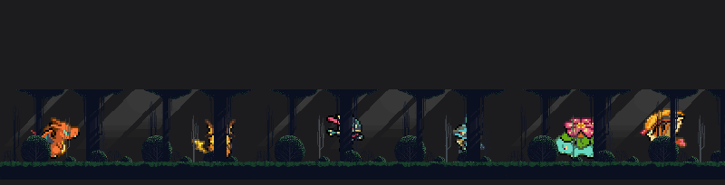
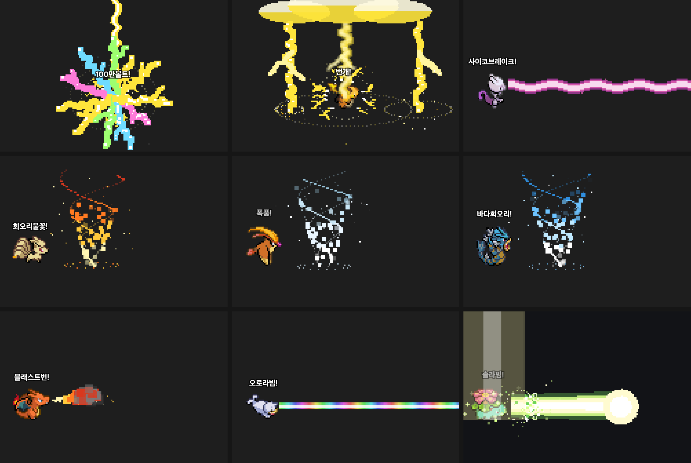
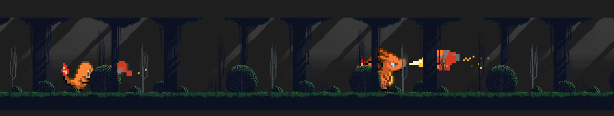
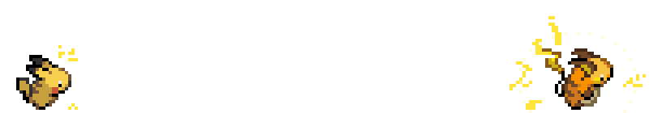
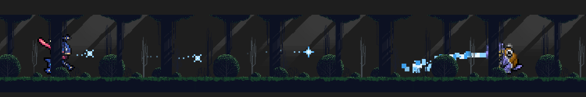
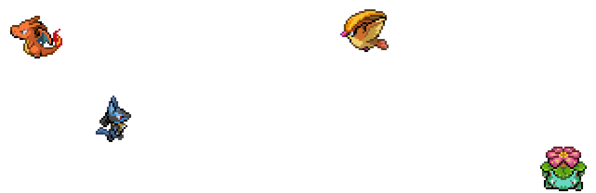
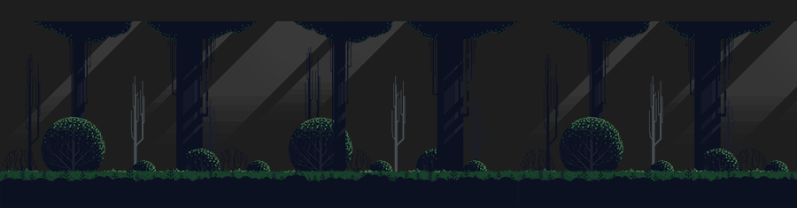
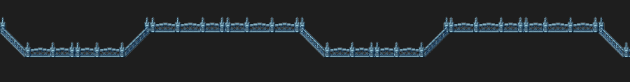
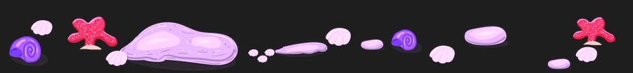

# VS Code Pokemon (한국어판 · 내 PC 전용)

**VS Code 패널에서 포켓몬을 키워요.** 클릭하면 기술을 쓰고, 잡아서 던지면 쿵 넘어지고, 날개 달린 애들은 하늘을 날아다녀요.

<p align="center"></p>

> 마켓의 [vscode-pokemon](https://github.com/jakobhoeg/vscode-pokemon) 5.0.2 를 바탕으로 고친 수정본이에요.
> 확장 이름이 `local.vscode-pokemon` 이라 마켓 업데이트와 상관없이 그대로 유지돼요.

## ✨ 이런 걸 할 수 있어요

### 🕹️ 직접 놀기

| | 이렇게 하면 | 이렇게 돼요 |
|:-:|---|---|
| 🖱️ | 포켓몬을 **클릭** | 기술을 써요 — 머리 위에 기술 이름이 떠요 |
| ✋ | 포켓몬을 **잡아서 끌기** | 잡혀 있는 동안 파닥파닥 바둥거려요 |
| 💫 | 높은 데서 **놓기** | 쿵 넘어져서 머리 위로 별이 빙글빙글 돌다가 비틀 일어나요 |
| ➕ | 패널 위 **+** | 포켓몬을 불러요 — 한글 이름으로 검색돼요 |
| ⚙️ | 패널 위 **⚙** | 기본 포켓몬 · 크기 · 배경 · 이름 언어를 한 번에 바꿔요 — 기본 포켓몬은 실수로 지워도 ↩ 되돌리기 |

### 🌟 1세대 151마리 — 모두 각자 기술

<p align="center"></p>

클릭하면 머리 위에 **"솔라빔!"** 처럼 기술 이름이 뜨고, 포켓몬마다 다른 기술을 써요.

| 연출 | 이런 기술 |
|:-:|---|
| 🔥 **뿜기** | 리자몽 블래스트번 · 미뇽 용의분노 · 또가스 독가스 · 프리져 눈보라 |
| ☀️ **광선** | 이상해꽃 솔라빔 · 갸라도스 파괴광선 · 쥬쥬 오로라빔(무지개) · 뮤츠 사이코브레이크 |
| 🌿 **채찍 · 실** | 이상해씨 덩굴채찍 · 캐터피 실뿜기 · 내루미 핥기 |
| 🎯 **날리기** | 쥬피썬더 바늘미사일 · 별가사리 스피드스타 · 나옹 고양이돈받기(동전) · 텅구리 뼈다귀부메랑 · 루주라 악마의키스(하트) |
| 🫧 **거품 · 물** | 꼬부기 거품 · 어니부기 물대포 · 라프라스 파도타기 |
| ✨ **가루** | 버터플 수면가루 · 뚜벅쵸 독가루 · 라플레시아 꽃잎댄스 |
| 🌀 **고리 · 물결** | 후딘 사이코키네시스 · 슬리프 최면술(소용돌이) · 피죤투 폭풍 · 주뱃 초음파 |
| ⚡ **번개** | 피카츄 10만볼트(몸 둘레) · 라이츄 · 썬더 번개(하늘에서 쾅) |
| 🌍 **땅 · 바위** | 니드킹 지진(다 같이 흔들) · 롱스톤 스톤샤워(바위가 우수수) |
| 💨 **몸으로** | 윈디 신속 · 꼬렛 전광석화 · 고지 구르기 · 날쌩마 플레어드라이브 |
| 💥 **치기 · 할퀴기** | 홍수몬 불꽃 · 냉동 · 번개펀치(매번 달라요) · 망키 마구할퀴기 · 쁘사이저 시저크로스 |
| 🛡️ **그 밖에** | 마임맨 배리어 · 럭키 알낳기 · 잠만보 잠자기(Z) · 푸린 노래하기(음표) |
| 🎲 **특별** | 잉어킹 튀어오르기 → *그러나 아무 일도 일어나지 않았다!* · 삐삐 손가락흔들기(다른 포켓몬 기술이 아무거나 나와요) |

<details>
<summary><b>151마리 기술 전체 보기</b></summary>

| No. | 포켓몬 | 기술 | No. | 포켓몬 | 기술 | No. | 포켓몬 | 기술 |
|--:|---|---|--:|---|---|--:|---|---|
| 001 | 이상해씨 | 덩굴채찍 | 002 | 이상해풀 | 잎날가르기 | 003 | 이상해꽃 | 솔라빔 |
| 004 | 파이리 | 불꽃세례 | 005 | 리자드 | 화염방사 | 006 | 리자몽 | 블래스트번 |
| 007 | 꼬부기 | 거품 | 008 | 어니부기 | 물대포 | 009 | 거북왕 | 하이드로캐논 |
| 010 | 캐터피 | 실뿜기 | 011 | 단데기 | 단단해지기 | 012 | 버터플 | 수면가루 |
| 013 | 뿔충이 | 독침 | 014 | 딱충이 | 단단해지기 | 015 | 독침붕 | 더블니들 |
| 016 | 구구 | 바람일으키기 | 017 | 피죤 | 날개치기 | 018 | 피죤투 | 폭풍 |
| 019 | 꼬렛 | 전광석화 | 020 | 레트라 | 필살앞니 | 021 | 깨비참 | 쪼기 |
| 022 | 깨비드릴조 | 회오리부리 | 023 | 아보 | 용해액 | 024 | 아보크 | 오물폭탄 |
| 025 | 피카츄 | 10만볼트 | 026 | 라이츄 | 번개 | 027 | 모래두지 | 구르기 |
| 028 | 고지 | 베어가르기 | 029 | 니드런♀ | 할퀴기 | 030 | 니드리나 | 독침 |
| 031 | 니드퀸 | 대지의힘 | 032 | 니드런♂ | 뿔찌르기 | 033 | 니드리노 | 독찌르기 |
| 034 | 니드킹 | 지진 | 035 | 삐삐 | 손가락흔들기 | 036 | 픽시 | 문라이트 |
| 037 | 식스테일 | 불꽃세례 | 038 | 나인테일 | 회오리불꽃 | 039 | 푸린 | 노래하기 |
| 040 | 푸크린 | 하이퍼보이스 | 041 | 주뱃 | 초음파 | 042 | 골뱃 | 흡혈 |
| 043 | 뚜벅쵸 | 독가루 | 044 | 냄새꼬 | 저리가루 | 045 | 라플레시아 | 꽃잎댄스 |
| 046 | 파라스 | 버섯포자 | 047 | 파라섹트 | 버섯포자 | 048 | 콘팡 | 환상빔 |
| 049 | 도나리 | 은빛바람 | 050 | 디그다 | 구멍파기 | 051 | 닥트리오 | 지진 |
| 052 | 나옹 | 고양이돈받기 | 053 | 페르시온 | 베어가르기 | 054 | 고라파덕 | 염동력 |
| 055 | 골덕 | 하이드로펌프 | 056 | 망키 | 마구할퀴기 | 057 | 성원숭 | 크로스촙 |
| 058 | 가디 | 불꽃세례 | 059 | 윈디 | 신속 | 060 | 발챙이 | 거품 |
| 061 | 슈륙챙이 | 최면술 | 062 | 강챙이 | 폭포오르기 | 063 | 캐이시 | 순간이동 |
| 064 | 윤겔라 | 환상빔 | 065 | 후딘 | 사이코키네시스 | 066 | 알통몬 | 태권당수 |
| 067 | 근육몬 | 지구던지기 | 068 | 괴력몬 | 다이너마이트펀치 | 069 | 모다피 | 덩굴채찍 |
| 070 | 우츠동 | 용해액 | 071 | 우츠보트 | 리프블레이드 | 072 | 왕눈해 | 용해액 |
| 073 | 독파리 | 오물웨이브 | 074 | 꼬마돌 | 돌떨구기 | 075 | 데구리 | 구르기 |
| 076 | 딱구리 | 대폭발 | 077 | 포니타 | 화염자동차 | 078 | 날쌩마 | 플레어드라이브 |
| 079 | 야돈 | 하품 | 080 | 야도란 | 염동력 | 081 | 코일 | 전기쇼크 |
| 082 | 레어코일 | 전자포 | 083 | 파오리 | 연속자르기 | 084 | 두두 | 쪼기 |
| 085 | 두트리오 | 난동부리기 | 086 | 쥬쥬 | 오로라빔 | 087 | 쥬레곤 | 냉동빔 |
| 088 | 질퍽이 | 오물공격 | 089 | 질뻐기 | 오물폭탄 | 090 | 셀러 | 고드름침 |
| 091 | 파르셀 | 스파이크캐논 | 092 | 고오스 | 핥기 | 093 | 고우스트 | 나이트헤드 |
| 094 | 팬텀 | 섀도볼 | 095 | 롱스톤 | 스톤샤워 | 096 | 슬리프 | 최면술 |
| 097 | 슬리퍼 | 사이코키네시스 | 098 | 크랩 | 거품광선 | 099 | 킹크랩 | 찝게햄머 |
| 100 | 찌리리공 | 자폭 | 101 | 붐볼 | 대폭발 | 102 | 아라리 | 최면술 |
| 103 | 나시 | 알폭탄 | 104 | 탕구리 | 뼈다귀치기 | 105 | 텅구리 | 뼈다귀부메랑 |
| 106 | 시라소몬 | 무릎차기 | 107 | 홍수몬 | 불꽃펀치 / 냉동펀치 / 번개펀치 | 108 | 내루미 | 핥기 |
| 109 | 또가스 | 독가스 | 110 | 또도가스 | 오물폭탄 | 111 | 뿔카노 | 돌진 |
| 112 | 코뿌리 | 뿔드릴 | 113 | 럭키 | 알낳기 | 114 | 덩쿠리 | 덩굴채찍 |
| 115 | 캥카 | 연속펀치 | 116 | 쏘드라 | 연막 | 117 | 시드라 | 하이드로펌프 |
| 118 | 콘치 | 뿔찌르기 | 119 | 왕콘치 | 폭포오르기 | 120 | 별가사리 | 스피드스타 |
| 121 | 아쿠스타 | 파워젬 | 122 | 마임맨 | 배리어 | 123 | 스라크 | 연속자르기 |
| 124 | 루주라 | 악마의키스 | 125 | 에레브 | 번개펀치 | 126 | 마그마 | 불꽃펀치 |
| 127 | 쁘사이저 | 시저크로스 | 128 | 켄타로스 | 돌진 | 129 | 잉어킹 | 튀어오르기 |
| 130 | 갸라도스 | 파괴광선 | 131 | 라프라스 | 파도타기 | 132 | 메타몽 | 변신 |
| 133 | 이브이 | 전광석화 | 134 | 샤미드 | 물의파동 | 135 | 쥬피썬더 | 바늘미사일 |
| 136 | 부스터 | 화염방사 | 137 | 폴리곤 | 트라이어택 | 138 | 암나이트 | 물대포 |
| 139 | 암스타 | 원시의힘 | 140 | 투구 | 할퀴기 | 141 | 투구푸스 | 베어가르기 |
| 142 | 프테라 | 날개치기 | 143 | 잠만보 | 잠자기 | 144 | 프리져 | 눈보라 |
| 145 | 썬더 | 번개 | 146 | 파이어 | 열풍 | 147 | 미뇽 | 용의분노 |
| 148 | 신뇽 | 용의숨결 | 149 | 망나뇽 | 역린 | 150 | 뮤츠 | 사이코브레이크 |
| 151 | 뮤 | 파동탄 |  |  |  |  |  |  |

</details>

### ⚔️ 2세대부터 — 타입별 기술

| 타입 | 기술 | 이런 애들 |
|:-:|---|---|
| 🔥 불꽃 | 입에서 불꽃이 활활, 센 애는 불똥까지 | 블레이범 · 번치코 · 초염몽 |
| 💧 물 | 물대포를 쭉 | 장크로다일 · 대짱이 · 엠페르트 |
| ⚡ 전기 | 몸 둘레로 번개가 지직 | 전룡 · 렌트라 · 에몽가 |
| 🍃 풀 | 나뭇잎이 빙글빙글 | 메가니움 · 나무킹 · 토대부기 |
| 🥷 전용기 | **물수리검** — 던지는 자세로 표창을 슝슝슝 | 개굴닌자 |

> 💪 **강할수록 화려해요.** 같은 기술이라도 진화할수록 크고 길어지고, 전설 포켓몬이 제일 화려해요.

### 🌿 저절로 하는 행동

| | 이렇게 돼요 |
|:-:|---|
| 🪽 **비행** | 날개 달린 포켓몬(리자몽 · 피죤투 · 망나뇽 · 크로뱃 …)이 가끔 하늘 높이 날아다니다 내려와요 |
| 🐸 **멀리뛰기** | 개구리 · 토끼 · 닌자 · 격투가(개굴닌자 · 루카리오 · 이어롭 · 피그점프 …)가 가끔 폴짝 뛰어요 |
| ✨ **혼자 기술** | 20초에 한 번쯤 누군가 혼자 기술을 써요 |

### 🇰🇷 편하게

- **완전 한국어** — 포켓몬 이름 · 메뉴 · 명령이 VS Code 언어와 상관없이 한국어로 나와요
- **6세대 추가** — 개구마르 · 개굴반장 · 개굴닌자를 부를 수 있어요
- **기본 포켓몬** — 정해 두면 새 작업 폴더나 다른 컴퓨터에서 패널이 비어 있을 때 자동으로 나와요
- **배경 자동 맞춤** — 숲 · 성 · 해변 배경이 패널 크기에 맞게 늘고 줄어요

### 🚀 부드럽고 가볍게

- 원본은 툭툭 끊기며 걸었는데, 이제 **매끄럽게** 걸어요 (다른 창이 바빠도 안 끊겨요)
- 포켓몬이 많아도 **VS Code 가 버벅이지 않게** 가볍게 만들었어요

## 📸 이렇게 나와요

> 실제 확장 코드로 찍은 화면입니다 (medium 크기, 배경 없이 — 배경은 아래 따로).

**🔥 불꽃 — 파이리 vs 리자몽** · 셀수록 불꽃이 크고 길게, 불똥까지 튐



**⚡ 전기 — 몸 둘레로 번개** · 셀수록 넓고 굵게 갈라짐 (1세대 라이츄는 이제 하늘에서 번개가 떨어져요 — 위 사진)



**💧 물 — 개굴닌자 물수리검 + 물대포** · 개굴닌자는 던지는 자세로 표창 3개



**🪽 비행 · 멀리뛰기 — 리자몽 · 피죤투 · 루카리오** · 날개 있는 애들은 패널 2/3 높이로, 개굴닌자류는 포물선으로 폴짝



### 🏞️ 배경

`vscode-pokemon.theme` 으로 고릅니다. 패널 높이에 맞춰 자동으로 늘고 줄어들고, 땅이 항상 포켓몬 발 높이에 옵니다 (아래는 어두운 테마 · medium 크기 원래 크기).

**🌲 forest**



**🏰 castle**



**🏖️ beach**



## 📦 새 컴퓨터에 설치

필요한 것: VS Code, Python 3

```bash
# 1. 마켓 버전이 깔려 있으면 지우기 (명령 · 패널 이름이 같아서 둘 다 있으면 충돌)
code --uninstall-extension jakobhoeg.vscode-pokemon

# 2. 받기 — 이 경로에 두면 Claude Code 전역 지침의 명령과 그대로 맞음
git clone https://github.com/taehyeon0412/vscode-pokemon-local.git ~/.claude/vscode-pokemon-local

# 3. 설치 (윈도우는 python install.py)
python3 ~/.claude/vscode-pokemon-local/install.py
```

4. VS Code 명령 팔레트(⌘⇧P)에서 **Developer: Reload Window**

`code` 명령을 못 찾으면 `install.py` 가 만든 `dist/local.vscode-pokemon-*.vsix` 를 VS Code 확장 탭 `…` → **Install from VSIX…** 로 설치해도 됩니다.

### 권장 설정 (settings.json)

```jsonc
"vscode-pokemon.pokemonSize": "nano",
"vscode-pokemon.theme": "forest",
// 설정 동기화가 켜져 있으면 — 다른 컴퓨터의 마켓 버전이 따라 들어와 충돌하지 않게
"settingsSync.ignoredExtensions": ["jakobhoeg.vscode-pokemon"],
```

### 포켓몬 목록 옮기기

포켓몬 목록과 위치는 VS Code 가 작업 폴더별로 저장해서 새 컴퓨터엔 없습니다.
**⚙ → 기본 포켓몬 → 지금 데리고 있는 포켓몬으로 저장** 해 두면 설정 동기화로 넘어가서, 새 컴퓨터에서 패널이 빈 채로 시작할 때 그 포켓몬들이 나옵니다.
`backup-pokemon-list.json` (원래 데리고 있던 18마리)을 쓰려면 명령 팔레트의 **포켓몬: 포켓몬 목록 가져오기** 에서 고르면 됩니다.

## 🛠️ 고치기

> 여기부터는 직접 고치거나 포켓몬을 더 넣고 싶은 사람을 위한 내용이에요.

모든 수정은 이 폴더에서 하고 마지막에 `python3 install.py` → Reload Window.

### 기술 · 행동 조절 — `moves.js`

맨 위 값만 바꾸고 `python3 make-moves.py` → `python3 install.py`

| 값 | 기본 | 뜻 |
|---|---|---|
| `MOVE_AUTO_AVG_SEC` | 20 | 평균 몇 초마다 누군가 저절로 기술 |
| `ACT_AUTO_AVG_SEC` | fly 25, jump 12 | 평균 몇 초마다 비행 · 점프 |
| `FLY_HEIGHT` | 2/3 | 비행 높이 (패널 높이 대비) |
| `MOVE_SPECIAL` | 개굴닌자 물수리검 | 전용기 (확률 · 그림 · 표창 수 · 간격) |

멀리뛰기 대상(`JUMPERS`)과 날개 없는 비행 타입 제외 목록(`WINGLESS`)은 `make-moves.py` 맨 위에 도감 번호로 있습니다.

### 1세대 기술 바꾸기 — `signature-moves.json`

포켓몬마다 `[기술 이름, 연출 틀, 옵션]` 한 줄이에요. 고친 뒤 `python3 make-moves.py` → `python3 install.py`

```jsonc
"venusaur": ["솔라빔", "beam", {"c": "solar", "width": 1.4, "sparkle": "solar"}],
// 여러 개를 주면 쓸 때마다 하나를 골라요
"hitmonchan": [["불꽃펀치", "punch", {"c": "fire"}], ["냉동펀치", "punch", {"c": "ice"}]]
```

- 연출 틀: `breath` 뿜기 · `beam` 광선 · `projectile` 날리기 · `bubbles` 거품 · `water` 물대포 · `powder` 가루 · `rings` 고리 · `spark` 스파크 · `bolt` 하늘 번개 · `glow` 반짝임 · `shield` 보호막 · `quake` 지진 · `rockfall` 바위 · `dash` 돌진 · `slash` 할퀴기 · `punch` 주먹 · `zzz` · `notes` 음표 · `splash` 튀어오르기 · `metronome` 손가락흔들기
- 색(`c`): `fire` `water` `ice` `grass` `solar` `electric` `psychic` `poison` `ghost` `dragon` `fairy` `rock` `ground` `steel` … (`moves.js` 의 `SIG_PALETTE`)
- 옵션은 `moves.js` 의 `SIG_FX` 각 틀 위 주석에 있어요 (`width` 굵기, `len` 길이, `n` 개수, `wave` 물결, `rainbow` 무지개, `arc` 포물선, `roll` 구르기 …)

### 포켓몬 추가 — `add-pokemon.py`

원본에 없는 포켓몬을 [PMD SpriteCollab](https://github.com/PMDCollab/SpriteCollab) 그림으로 만들어 등록합니다 (걷기 · 서 있기, 색이 다른 개체 포함, 한글 이름, 기술 표까지).

```bash
pip3 install pillow          # 처음 한 번 (Node.js 도 필요)
python3 add-pokemon.py 658 greninja Greninja 개굴닌자   # 도감번호 키 영문이름 한글이름
python3 install.py
```

## 📁 폴더 구조

```
extension/        확장 본체 (원본 + 수정) — install.py 가 이걸 묶어 설치
moves.js          기술 · 행동 코드 원본 — make-moves.py 가 extension/media/main-bundle.js 에 끼워 넣음
make-moves.py     타입 · 종족값 · 입 위치로 기술 표 + 행동 표 + 1세대 전용 기술 표 생성
signature-moves.json  1세대 151마리 전용 기술 (이름 · 연출 틀 · 색)
add-pokemon.py    포켓몬 추가 (그림 생성 + 등록)
install.py        vsix 로 묶어 설치 (install.sh 는 예전 명령용)
pokemon.json      add-pokemon 으로 추가한 포켓몬 목록
pokemon-types.json / pokemon-stats.json   PokeAPI 타입 · 종족값 저장본 (다시 안 받음)
backup-pokemon-list.json                  옮기기 전 포켓몬 목록
docs/             README 그림 (데모 · 장면 캡처)
```

### 원본 코드에서 바꾼 곳

찾기 쉽게 모두 주석 표시가 붙어 있습니다.

| 표시 | 위치 | 내용 |
|---|---|---|
| `POKEMON-FIT-PATCH` | `media/main-bundle.js` | 배경 자동 맞춤 |
| `POKEMON-EXTRA-PATCH` | `main-bundle.js`, `out/common/pokemon-data.js` · `types.js` · `localize.js` | 추가 포켓몬 데이터 · 6세대 메뉴 · 한글 이름 세대 (add-pokemon.py 가 다시 씀) |
| `POKEMON-MOVES-PATCH` | `main-bundle.js` | 기술 · 1세대 전용 기술 · 행동 · 드래그 (make-moves.py 가 다시 씀) |
| `LOCAL-PATCH` | `main-bundle.js`, `media/pokemon.css` | 저장 1초에 한 번, GPU 이동(`glideSprite`) |
| `LOCAL-PATCH` | `out/extension/extension.js`, `main-bundle.js` | ⚙ 설정 메뉴(`vscode-pokemon.settings-menu`), 빈 패널이 `fresh-session` 을 보내면 기본 포켓몬 소환 |
| `LOCAL-PATCH` | `out/extension/extension.js`, `out/common/localize.js` | 메뉴 문구를 `koT` 로 `l10n/bundle.l10n.ko.json` 에서 (VS Code 언어 무시), 이름 언어 자동 → 한국어 |
| — | `package.json` | publisher `local`, 이름 "VS Code Pokemon (내 PC)", 명령 · 패널 · 설정 이름 한국어, `pokemonLanguage` 기본 `ko` |
| — | `out/common/localize.js` | 확장 ID 를 `local.vscode-pokemon` 으로 |
| — | `l10n/pokemon/ko/` | 한글 이름 (PokeAPI) |

## 📜 출처 · 라이선스

- 원작 코드: [jakobhoeg/vscode-pokemon](https://github.com/jakobhoeg/vscode-pokemon) — CC0
- 포켓몬 그림 저작권: © The Pokémon Company / Nintendo / Game Freak — 개인 비상업 용도
- 6세대 그림: [PMD SpriteCollab](https://github.com/PMDCollab/SpriteCollab) — CC BY-NC 4.0 (작가는 저장소 `sprite/<번호>/credits.txt`)
- 타입 · 종족값 · 한글 이름: [PokeAPI](https://github.com/PokeAPI/pokeapi)
