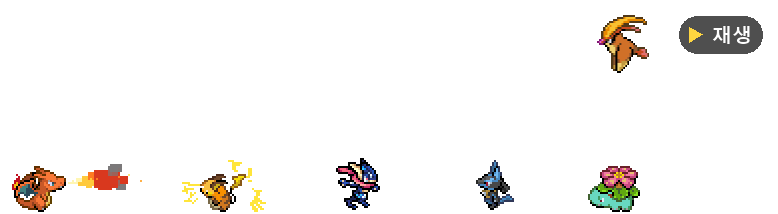
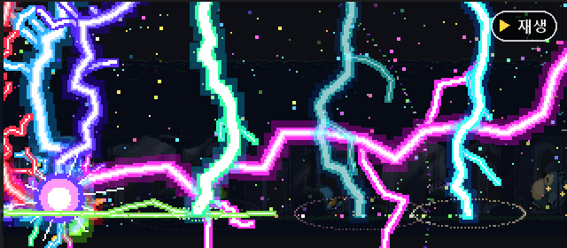
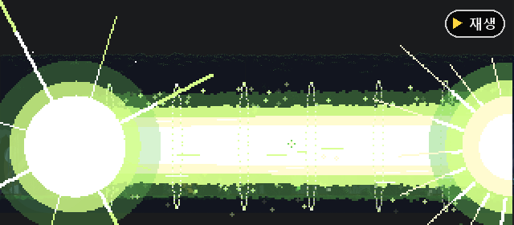
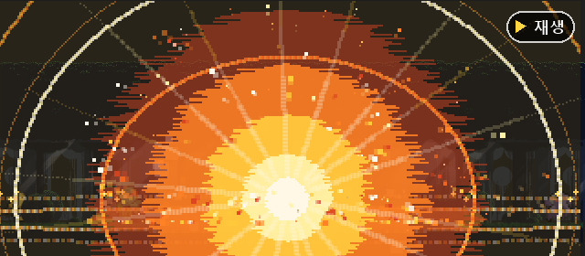
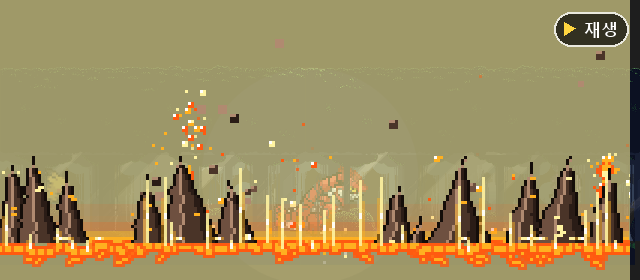
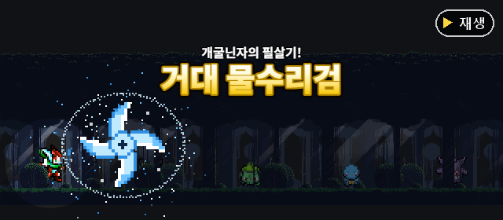
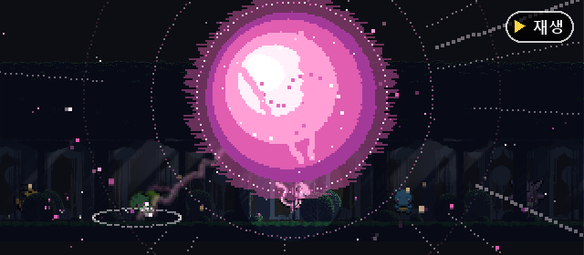
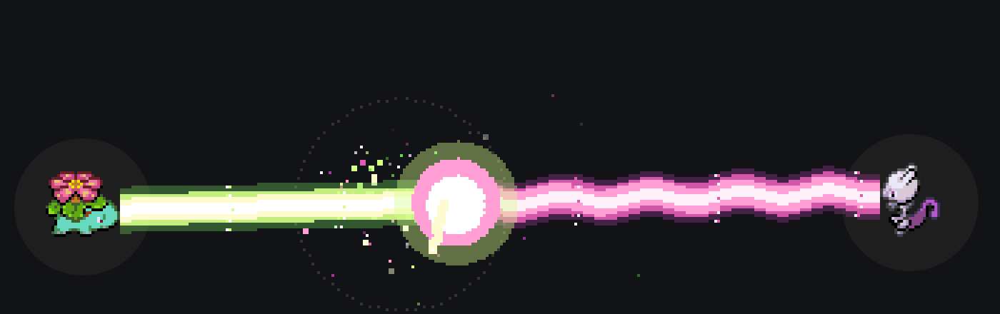

<div align="center">

# 🎮 VS Code Pokemon

**한국어판 · 내 PC 전용**

VS Code 패널에서 포켓몬을 키워요<br>
클릭하면 기술 · 꾹 누르면 필살기 · 잡아서 던지면 쿵 · 날개 달린 애들은 하늘로


<a href="docs/demo.gif"></a>

<sub>그림 오른쪽 위 <b>▶ 재생</b> 을 누르면 움직이는 장면이 열려요</sub>

**[🕹️ 놀기](#play) · [💥 필살기](#ult) · [⚡ 기술](#moves) · [🌿 저절로](#auto) · [📦 설치](#install) · [🛠️ 고치기](#dev)**

</div>

> [!NOTE]
> 마켓의 [vscode-pokemon](https://github.com/jakobhoeg/vscode-pokemon) 5.0.2 를 고친 수정본이에요.<br>
> 확장 이름이 `local.vscode-pokemon` 이라 마켓 업데이트와 상관없이 그대로예요.

<br>

<a id="play"></a>

## 🕹️ 이렇게 놀아요

| | 이렇게 하면 | 이렇게 돼요 |
|:-:|:--|:--|
| 🖱️ | **클릭** | 기술 — 화면 가운데 쪽을 보고 쓰고, 머리 위에 기술 이름이 떠요 |
| 💥 | **1초&nbsp;꾹&nbsp;누르기** | **필살기** — 화면이 어두워지고 컷인 · 큰 글씨와 함께 |
| ✋ | **잡아서&nbsp;끌기** | 잡혀 있는 동안 파닥파닥 바둥거려요 |
| 💫 | **높은&nbsp;데서&nbsp;놓기** | 쿵 넘어져 머리 위로 별이 빙글빙글, 비틀 일어나요 |
| ➕ | 패널&nbsp;위&nbsp;**＋** | 포켓몬 부르기 — 한글 이름으로 검색돼요 |
| 🗑️ | 패널&nbsp;위&nbsp;**휴지통** | 한 마리씩 · 모두 지우기 — 알림의 **[되돌리기]** 로 다시 불러와요 |
| ⚙️ | 패널&nbsp;위&nbsp;**⚙** | 기본 포켓몬 · 크기 · 배경 · 이름 언어를 한 번에 |

<br>

<a id="ult"></a>

## 💥 필살기

**포켓몬을 1초 넘게 꾹 누르면** 기운이 차오르다가 필살기가 나가요.

<table>
<tr>
<td align="center"><a href="docs/ult-pikachu.gif"></a><br><b>피카츄</b> · 1000만볼트</td>
<td align="center"><a href="docs/ult-venusaur.gif"></a><br><b>이상해꽃</b> · 솔라빔</td>
</tr>
<tr>
<td align="center"><a href="docs/ult-charizard.gif"></a><br><b>리자몽</b> · 블래스트번</td>
<td align="center"><a href="docs/ult-groudon.gif"></a><br><b>그란돈</b> · 단애의칼</td>
</tr>
<tr>
<td align="center"><a href="docs/ult-greninja.gif"></a><br><b>개굴닌자</b> · 거대 물수리검</td>
<td align="center"><a href="docs/ult-mew.gif"></a><br><b>뮤</b> · 오리진즈슈퍼노바</td>
</tr>
</table>

### 이렇게 나가요

| | |
|:-:|:--|
| **①&nbsp;누르는&nbsp;동안** | 빛이 몸으로 빨려 들고 발밑 고리가 차오르며 부르르, 화면이 서서히 어두워져요 |
| **②&nbsp;번쩍** | 그 포켓몬만 빛을 받고, 큰 그림이 가로 띠로 휙 — **"리자몽의 필살기! 블래스트번"** |
| **③&nbsp;필살기** | 평소 기술보다 훨씬 크게 — 맞은 포켓몬은 벌러덩 · 떠오름 · 빙글 |

> 1초 전에 떼면 평소처럼 기술, 누른 채 움직이면 잡기예요.

### 637마리 모두 2개 이상

- 서로 다른 연출로 쓸 때마다 **번갈아** 나와요 — 한 바퀴 다 나올 때까지 같은 게 안 나와요
- 이름은 **Z기술 · 거다이맥스 · 전용기 · 대표 기술**에서 골랐어요
- **광선 쓰는 애들은 거대 광선** — 솔라빔 · 파괴광선 · 사이코브레이크 · 오로라빔(무지개) …

| 포켓몬 | 필살기 |
|:--|:--|
| ⚡&nbsp;**피카츄** | 100만볼트(노란 번개) · 1000만볼트(무지개 번개 11줄기 + 거대 번개 기둥) |
| ⚡&nbsp;**라이츄** | 라이트닝서프라이드 · 스파킹기가볼트(번개 창) |
| 🔥&nbsp;**리자몽** | 블래스트번(대폭발) · 블래스트번(파란 불꽃 구체) |
| 🌿&nbsp;**이상해꽃** | 솔라빔 · 하드플랜트(꼬인 덩굴 기둥) |
| 💧&nbsp;**거북왕** | 하이드로캐논(두 줄 광선) · 거다이포격(폭우) |
| 🥷&nbsp;**개굴닌자** | 거대 물수리검 · 물의파동(하늘의 거대 물 구체) |
| 🌋&nbsp;**그란돈** | 단애의칼(용암 지진) · 분화 · 솔라빔 |
| ⏳&nbsp;**디아루가** | 시간의포효 · 용성군 |
| 🌸&nbsp;**뮤** | 오리진즈슈퍼노바 · 사이코키네시스 |

### ⚔️ 필살기 대결

꾹 눌러 쓰면 **절반쯤**, 멀리 있는 포켓몬이 자기 필살기로 받아쳐요.

| | |
|:-:|:--|
| **VS** | 위아래 두 컷인과 가운데 **VS** 쾅 |
| **맞부딪힘** | **서로의 고유 필살기가 그 모양 그대로** — 불덩이 vs 몸통 돌진, 거대 광선 vs 바위 기둥, 회오리 vs 용성군 … |
| **밀고&nbsp;밀리기** | 가운데서 한쪽씩 밀어붙이고, 막판엔 점점 격해져요 |
| **결과** | 센 쪽 필살기가 뚫고 나가 **그 방식으로** 진 쪽에서 터져요 — **"효과는 굉장했다!"** · 무승부면 가운데서 대폭발 |

### 🎲 재미있는 애들

- **잉어킹** — 화면 끝까지 튀어올랐다가 *"그러나 아무 일도 일어나지 않았다!"* (가끔 갸라도스로 변해 파괴광선)
- **메타몽** — 가장 가까운 포켓몬으로 변신해 그 애의 필살기
- **삐삐** — 손가락흔들기로 아무 필살기나

### 연출 종류

| 연출 | 이런 필살기 |
|:--|:--|
| ☀️&nbsp;**거대&nbsp;광선** | 솔라빔 · 파괴광선 · 하이드로캐논 · 사이코브레이크 · 냉동빔 — 모아서 화면 끝까지 |
| 🔥&nbsp;**구체&nbsp;·&nbsp;대폭발** | 다이내믹풀플레임 · 섀도볼 · 파동탄 · 오리진즈슈퍼노바 · 대폭발 — 화면이 하얗게 |
| 🌑&nbsp;**블랙홀&nbsp;·&nbsp;그림자** | 블랙홀이클립스(다른 애들을 빨아들임) · 무한암야로의유인(그림자 손) |
| 🌍&nbsp;**땅&nbsp;·&nbsp;자연** | 라이징랜드오버 · 단애의칼 · 스톤에지 · 블룸샤인엑스트라 · 하이드로보텍스 |
| ⛈️&nbsp;**하늘&nbsp;·&nbsp;날씨** | 번개 폭풍 · 눈보라 · 월즈엔드폴 · 용성군 · 스파킹기가볼트 · 1000만볼트 |
| 🎯&nbsp;**날리기** | 바늘미사일 · 리프스톰 · 스피드스타 · 거대 물수리검 |
| 💨&nbsp;**몸&nbsp;·&nbsp;마음** | 울트라대시어택 · 파이널다이브클래시 · 전력무쌍격렬권 · 맥시멈사이브레이커 |

<details>
<summary><b>타입 기본 필살기 (Z기술)</b></summary>

<br>

| 타입 | 필살기 | 타입 | 필살기 | 타입 | 필살기 |
|:--|:--|:--|:--|:--|:--|
| 노말 | 울트라대시어택 | 불꽃 | 다이내믹풀플레임 | 물 | 하이드로보텍스 |
| 풀 | 블룸샤인엑스트라 | 전기 | 스파킹기가볼트 | 얼음 | 레이징지오프리즈 |
| 격투 | 전력무쌍격렬권 | 독 | 애시드포이즌딜리트 | 땅 | 라이징랜드오버 |
| 비행 | 파이널다이브클래시 | 에스퍼 | 맥시멈사이브레이커 | 벌레 | 절대포식회전참 |
| 바위 | 월즈엔드폴 | 고스트 | 무한암야로의유인 | 드래곤 | 얼티메이트드래곤번 |
| 악 | 블랙홀이클립스 | 강철 | 초월나선연격 | 페어리 | 러블리스타임팩트 |

</details>

<br>

<a id="moves"></a>

## ⚡ 기술 (클릭)

<p align="center"></p>

클릭할 때마다 그 포켓몬이 쓸 수 있는 기술 중 **하나가 무작위로** 나오고, 머리 위에 **"솔라빔!"** 처럼 이름이 떠요.

- **쓸 수 있는 기술 = 대표 기술 + 타입 기술** (강할수록 센 기술까지) — 예: 리자몽은 블래스트번 · 화염방사 · 회오리불꽃 · 날개치기 · 폭풍 …
- **1~6세대 모두** 대표 기술이 있어요 — 루카리오 파동탄, 한카리아스 드래곤다이브, 핫삼 불릿펀치, 마기라스 스톤에지 …
- **광선 쓰는 애들은 클릭해도 광선** — 라플레시아 솔라빔, 망나뇽 · 폴리곤2 파괴광선, 레지 삼총사, 리그레 환상빔 …
- 🥷 개굴닌자는 던지는 자세로 **물수리검**을 슝슝슝

> 💪 **강할수록 화려해요.** 같은 기술이라도 진화할수록 크고 길어지고, 전설 포켓몬이 제일 화려해요.

### ⚔️ 광선 힘겨루기

<p align="center"><a href="docs/clash.gif"></a></p>

광선 기술을 쏘면 **절반쯤**, 바라보는 쪽 가장 먼 곳의 광선 쓰는 포켓몬이 돌아서서 받아쳐요.

| | |
|:-:|:--|
| **①&nbsp;모으기** | 화면이 어두워지고 두 포켓몬에게만 빛 — 둘 다 빛을 모아요 |
| **②&nbsp;쾅** | 두 광선이 가운데서 부딪혀 3초 넘게 밀고 밀려요 — 에너지가 솟구치고 번개가 땅에 꽂혀요 |
| **③&nbsp;결과** | 센 쪽이 더 잘 이기지만 가끔 역전 — 이긴 광선이 뚫고 나가 **"효과는 굉장했다!"** · 무승부면 대폭발 |

### 기술 종류

| 연출 | 이런 기술 |
|:--|:--|
| 🔥&nbsp;**뿜기** | 리자몽 블래스트번 · 미뇽 용의분노 · 또가스 독가스 · 프리져 눈보라 |
| 🌪️&nbsp;**회오리** | 회오리불꽃 · 바다회오리 · 모래지옥 · 폭풍 — 앞에 회오리 기둥이 꼬이며 솟아요 |
| ☀️&nbsp;**광선** | 솔라빔 · 파괴광선 · 오로라빔(무지개) · 사이코브레이크 |
| 🌿&nbsp;**채찍&nbsp;·&nbsp;실** | 덩굴채찍 · 실뿜기 · 핥기 |
| 🎯&nbsp;**날리기** | 바늘미사일 · 스피드스타 · 고양이돈받기(동전) · 뼈다귀부메랑 · 악마의키스(하트) |
| 🫧&nbsp;**거품&nbsp;·&nbsp;물** | 거품 · 물대포 · 파도타기 |
| ✨&nbsp;**가루** | 수면가루 · 독가루 · 꽃잎댄스 |
| 🌀&nbsp;**고리&nbsp;·&nbsp;물결** | 사이코키네시스 · 최면술(소용돌이) · 폭풍 · 초음파 |
| ⚡&nbsp;**번개** | 100만볼트(사방으로 무지개빛 번개) · 번개(먹구름에서 쾅쾅) |
| 🌍&nbsp;**땅&nbsp;·&nbsp;바위** | 지진(다 같이 흔들) · 스톤샤워(바위가 우수수) |
| 💨&nbsp;**몸으로** | 신속 · 전광석화 · 구르기 · 플레어드라이브 |
| 💥&nbsp;**치기&nbsp;·&nbsp;할퀴기** | 불꽃 · 냉동 · 번개펀치 · 마구할퀴기 · 시저크로스 |
| 🛡️&nbsp;**그&nbsp;밖에** | 배리어 · 알낳기 · 잠자기(Z) · 노래하기(음표) |
| 🎲&nbsp;**특별** | 잉어킹 튀어오르기 · 삐삐 손가락흔들기(다른 포켓몬 기술이 아무거나) |

<details>
<summary><b>1세대 151마리 대표 기술 전체 보기</b></summary>

<br>

| No. | 포켓몬 | 기술 | No. | 포켓몬 | 기술 | No. | 포켓몬 | 기술 |
|--:|:--|:--|--:|:--|:--|--:|:--|:--|
| 001 | 이상해씨 | 덩굴채찍 | 002 | 이상해풀 | 잎날가르기 | 003 | 이상해꽃 | 솔라빔 |
| 004 | 파이리 | 불꽃세례 | 005 | 리자드 | 화염방사 | 006 | 리자몽 | 블래스트번 |
| 007 | 꼬부기 | 거품 | 008 | 어니부기 | 물대포 | 009 | 거북왕 | 하이드로캐논 |
| 010 | 캐터피 | 실뿜기 | 011 | 단데기 | 단단해지기 | 012 | 버터플 | 수면가루 |
| 013 | 뿔충이 | 독침 | 014 | 딱충이 | 단단해지기 | 015 | 독침붕 | 더블니들 |
| 016 | 구구 | 바람일으키기 | 017 | 피죤 | 날개치기 | 018 | 피죤투 | 폭풍 |
| 019 | 꼬렛 | 전광석화 | 020 | 레트라 | 필살앞니 | 021 | 깨비참 | 쪼기 |
| 022 | 깨비드릴조 | 회오리부리 | 023 | 아보 | 용해액 | 024 | 아보크 | 오물폭탄 |
| 025 | 피카츄 | 100만볼트 | 026 | 라이츄 | 번개 | 027 | 모래두지 | 구르기 |
| 028 | 고지 | 베어가르기 | 029 | 니드런♀ | 할퀴기 | 030 | 니드리나 | 독침 |
| 031 | 니드퀸 | 대지의힘 | 032 | 니드런♂ | 뿔찌르기 | 033 | 니드리노 | 독찌르기 |
| 034 | 니드킹 | 지진 | 035 | 삐삐 | 손가락흔들기 | 036 | 픽시 | 문라이트 |
| 037 | 식스테일 | 불꽃세례 | 038 | 나인테일 | 회오리불꽃 | 039 | 푸린 | 노래하기 |
| 040 | 푸크린 | 하이퍼보이스 | 041 | 주뱃 | 초음파 | 042 | 골뱃 | 흡혈 |
| 043 | 뚜벅쵸 | 독가루 | 044 | 냄새꼬 | 저리가루 | 045 | 라플레시아 | 꽃잎댄스 |
| 046 | 파라스 | 버섯포자 | 047 | 파라섹트 | 버섯포자 | 048 | 콘팡 | 환상빔 |
| 049 | 도나리 | 은빛바람 | 050 | 디그다 | 구멍파기 | 051 | 닥트리오 | 지진 |
| 052 | 나옹 | 고양이돈받기 | 053 | 페르시온 | 베어가르기 | 054 | 고라파덕 | 염동력 |
| 055 | 골덕 | 하이드로펌프 | 056 | 망키 | 마구할퀴기 | 057 | 성원숭 | 크로스촙 |
| 058 | 가디 | 불꽃세례 | 059 | 윈디 | 신속 | 060 | 발챙이 | 거품 |
| 061 | 슈륙챙이 | 최면술 | 062 | 강챙이 | 폭포오르기 | 063 | 캐이시 | 순간이동 |
| 064 | 윤겔라 | 환상빔 | 065 | 후딘 | 사이코키네시스 | 066 | 알통몬 | 태권당수 |
| 067 | 근육몬 | 지구던지기 | 068 | 괴력몬 | 다이너마이트펀치 | 069 | 모다피 | 덩굴채찍 |
| 070 | 우츠동 | 용해액 | 071 | 우츠보트 | 리프블레이드 | 072 | 왕눈해 | 용해액 |
| 073 | 독파리 | 오물웨이브 | 074 | 꼬마돌 | 돌떨구기 | 075 | 데구리 | 구르기 |
| 076 | 딱구리 | 대폭발 | 077 | 포니타 | 화염자동차 | 078 | 날쌩마 | 플레어드라이브 |
| 079 | 야돈 | 하품 | 080 | 야도란 | 염동력 | 081 | 코일 | 전기쇼크 |
| 082 | 레어코일 | 전자포 | 083 | 파오리 | 연속자르기 | 084 | 두두 | 쪼기 |
| 085 | 두트리오 | 난동부리기 | 086 | 쥬쥬 | 오로라빔 | 087 | 쥬레곤 | 냉동빔 |
| 088 | 질퍽이 | 오물공격 | 089 | 질뻐기 | 오물폭탄 | 090 | 셀러 | 고드름침 |
| 091 | 파르셀 | 스파이크캐논 | 092 | 고오스 | 핥기 | 093 | 고우스트 | 나이트헤드 |
| 094 | 팬텀 | 섀도볼 | 095 | 롱스톤 | 스톤샤워 | 096 | 슬리프 | 최면술 |
| 097 | 슬리퍼 | 사이코키네시스 | 098 | 크랩 | 거품광선 | 099 | 킹크랩 | 찝게햄머 |
| 100 | 찌리리공 | 자폭 | 101 | 붐볼 | 대폭발 | 102 | 아라리 | 최면술 |
| 103 | 나시 | 알폭탄 | 104 | 탕구리 | 뼈다귀치기 | 105 | 텅구리 | 뼈다귀부메랑 |
| 106 | 시라소몬 | 무릎차기 | 107 | 홍수몬 | 불꽃 · 냉동 · 번개펀치 | 108 | 내루미 | 핥기 |
| 109 | 또가스 | 독가스 | 110 | 또도가스 | 오물폭탄 | 111 | 뿔카노 | 돌진 |
| 112 | 코뿌리 | 뿔드릴 | 113 | 럭키 | 알낳기 | 114 | 덩쿠리 | 덩굴채찍 |
| 115 | 캥카 | 연속펀치 | 116 | 쏘드라 | 연막 | 117 | 시드라 | 하이드로펌프 |
| 118 | 콘치 | 뿔찌르기 | 119 | 왕콘치 | 폭포오르기 | 120 | 별가사리 | 스피드스타 |
| 121 | 아쿠스타 | 파워젬 | 122 | 마임맨 | 배리어 | 123 | 스라크 | 연속자르기 |
| 124 | 루주라 | 악마의키스 | 125 | 에레브 | 번개펀치 | 126 | 마그마 | 불꽃펀치 |
| 127 | 쁘사이저 | 시저크로스 | 128 | 켄타로스 | 돌진 | 129 | 잉어킹 | 튀어오르기 |
| 130 | 갸라도스 | 파괴광선 | 131 | 라프라스 | 파도타기 | 132 | 메타몽 | 변신 |
| 133 | 이브이 | 전광석화 | 134 | 샤미드 | 물의파동 | 135 | 쥬피썬더 | 바늘미사일 |
| 136 | 부스터 | 화염방사 | 137 | 폴리곤 | 트라이어택 | 138 | 암나이트 | 물대포 |
| 139 | 암스타 | 원시의힘 | 140 | 투구 | 할퀴기 | 141 | 투구푸스 | 베어가르기 |
| 142 | 프테라 | 날개치기 | 143 | 잠만보 | 잠자기 | 144 | 프리져 | 눈보라 |
| 145 | 썬더 | 번개 | 146 | 파이어 | 열풍 | 147 | 미뇽 | 용의분노 |
| 148 | 신뇽 | 용의숨결 | 149 | 망나뇽 | 역린 | 150 | 뮤츠 | 사이코브레이크 |
| 151 | 뮤 | 파동탄 |  |  |  |  |  |  |

</details>

<br>

<a id="auto"></a>

## 🌿 저절로 하는 행동

| | |
|:--|:--|
| 🪽&nbsp;**비행** | 날개 달린 포켓몬(리자몽 · 피죤투 · 망나뇽 · 크로뱃 …)이 가끔 하늘 높이 날다 내려와요 |
| 🐸&nbsp;**멀리뛰기** | 개구리 · 토끼 · 닌자 · 격투가(개굴닌자 · 루카리오 · 이어롭 …)가 가끔 폴짝 |
| ✨&nbsp;**혼자&nbsp;기술** | 20초에 한 번쯤 누군가 혼자 기술을 써요 |

### 🇰🇷 편하고 가볍게

| | |
|:--|:--|
| **완전&nbsp;한국어** | 포켓몬 이름 · 메뉴 · 명령이 VS Code 언어와 상관없이 한국어 |
| **6세대&nbsp;추가** | 개구마르 · 개굴반장 · 개굴닌자 |
| **기본&nbsp;포켓몬** | ⚙ → 기본 포켓몬에서 체크만 — 새 작업 폴더 · 다른 컴퓨터에서 빈 패널이면 자동으로 나와요 |
| **배경&nbsp;자동&nbsp;맞춤** | 숲 · 성 · 해변 배경이 패널 크기에 맞게 늘고 줄어요 |
| **매끄럽게** | 원본은 툭툭 끊기며 걸었는데, 이제 다른 창이 바빠도 부드럽게 걸어요 |
| **가볍게** | 포켓몬이 많아도 VS Code 가 버벅이지 않아요 |

<br>

## 📸 이렇게 나와요

<sub>실제 확장 코드로 찍은 화면 (medium 크기 · 배경 없이)</sub>

**🔥 불꽃 — 파이리 vs 리자몽** · 셀수록 불꽃이 크고 길게, 불똥까지


**⚡ 전기 — 피카츄 · 라이츄** · 셀수록 넓고 굵게 갈라지는 번개


**💧 물 — 개굴닌자 물수리검 + 물대포** · 던지는 자세로 표창 3개


**🪽 비행 · 멀리뛰기 — 리자몽 · 피죤투 · 루카리오** · 날개 있는 애들은 패널 2/3 높이로, 개굴닌자류는 포물선으로 폴짝


### 🏞️ 배경

`vscode-pokemon.theme` 으로 골라요. 패널 높이에 맞춰 늘고 줄고, 땅은 항상 포켓몬 발 높이예요 (어두운 테마 · medium 크기).

| 🌲 forest | 🏰 castle | 🏖️ beach |
|:-:|:-:|:-:|
|  |  |  |

<br>

<a id="install"></a>

## 📦 새 컴퓨터에 설치

필요한 것: **VS Code** · **Python 3**

```bash
# 1. 마켓 버전이 깔려 있으면 지우기 (명령 · 패널 이름이 같아서 둘 다 있으면 충돌)
code --uninstall-extension jakobhoeg.vscode-pokemon

# 2. 받기 — 이 경로에 두면 Claude Code 전역 지침의 명령과 그대로 맞음
git clone https://github.com/taehyeon0412/vscode-pokemon-local.git ~/.claude/vscode-pokemon-local

# 3. 설치 (윈도우는 python install.py)
python3 ~/.claude/vscode-pokemon-local/install.py
```

4. VS Code 명령 팔레트(⌘⇧P / Ctrl+Shift+P)에서 **Developer: Reload Window**

> [!TIP]
> `code` 명령을 못 찾으면 `install.py` 가 만든 `dist/local.vscode-pokemon-*.vsix` 를 확장 탭 `…` → **Install from VSIX…** 로 설치해도 돼요.

<details>
<summary><b>권장 설정 (settings.json)</b></summary>

<br>

```jsonc
"vscode-pokemon.pokemonSize": "nano",
"vscode-pokemon.theme": "forest",
// 설정 동기화가 켜져 있으면 — 다른 컴퓨터의 마켓 버전이 따라 들어와 충돌하지 않게
"settingsSync.ignoredExtensions": ["jakobhoeg.vscode-pokemon"],
```

</details>

<details>
<summary><b>포켓몬 목록 옮기기</b></summary>

<br>

포켓몬 목록과 위치는 VS Code 가 작업 폴더별로 저장해서 새 컴퓨터엔 없어요.

- **⚙ → 기본 포켓몬 → 지금 데리고 있는 포켓몬으로 저장** 해 두면 설정 동기화로 넘어가서, 새 컴퓨터에서 패널이 빈 채로 시작할 때 그 포켓몬들이 나와요
- `backup-pokemon-list.json` (원래 데리고 있던 18마리)은 명령 팔레트 **포켓몬: 포켓몬 목록 가져오기** 에서 골라요

</details>

<br>

<a id="dev"></a>

## 🛠️ 고치기

<sub>직접 고치거나 포켓몬을 더 넣고 싶은 사람을 위한 내용이에요. 모든 수정은 이 폴더에서 하고 마지막에 <code>python3 install.py</code> → Reload Window.</sub>

<details>
<summary><b>필살기 · 2세대부터 기술 바꾸기 — <code>moves-data/*.json</code></b></summary>

<br>

세대별 파일(`gen1` `gen2` `gen3` `gen4` `gen56`)에 포켓몬마다 한 줄 — `moves` 는 클릭 기술에 더할 것, `ult` 는 필살기 `[이름, 필살기 틀, 옵션]` (여러 개면 번갈아).

```jsonc
"dragonite": {
  "moves": [["파괴광선", "beam", {"c": "hyper", "width": 1.4, "sparkle": "hyper"}]],
  "ult": [["파괴광선", "ultbeam", {"c": "hyper", "width": 1.3}], ["역린", "ultrush", {"c": "dragon", "fast": 1}]]
},
"unown": { "ult": ["잠재파워", "ultorb", {"c": "hypno"}] }   // unown_a … 모두 (밑줄 앞 이름으로 찾음)
```

고친 뒤 `python3 dev/validate-data.py` 로 검사 → `python3 make-moves.py` → `python3 install.py`

- 필살기 틀 22개와 옵션은 [`ult/SPEC.md`](ult/SPEC.md)
- 필살기가 없으면 `make-moves.py` 의 `TYPE_ULTS`(타입 기본)
- 꾹 누르는 시간 · 연출 길이 · 대결 확률은 `ult/core.js` 맨 위 — `ULT_HOLD_MS`(1초) · `ULT_INTRO_MS` · `ULT_DIM`(어둡기) · `ULT_CLASH_CHANCE`(0.5)

</details>

<details>
<summary><b>필살기 연출 고치기 — <code>ult/</code></b></summary>

<br>

| 파일 | 내용 |
|:--|:--|
| `core.js` | 꾹 누르기 · 기 모으기 · 시작 연출 · 도구 · 특수 필살기 |
| `fx-energy.js` `fx-earth.js` `fx-sky.js` `fx-body.js` | 필살기 연출 틀 22가지 |
| `duel.js` + `duel-*.js` | 필살기 대결 — 엔진 + 모양 11가지 |
| `SPEC.md` | 설계 · 약속 (만드는 법) |

VS Code 없이 브라우저로 보기 — 이 폴더에서 `python3 -m http.server 8765` → <http://localhost:8765/dev/preview.html> (포켓몬마다 필살기 · 기술 버튼, 틀 · 옵션 시험)

점검 — `python3 dev/smoke.py --fx all` (머리 없는 Edge/Chrome 으로 모든 틀을 돌려 오류 · 입자 수) · 대결 `--fx duel` · 장면 사진 `--shot ultbeam --at 1500,2500`

</details>

<details>
<summary><b>기술 · 행동 조절 — <code>moves.js</code></b></summary>

<br>

맨 위 값만 바꾸고 `python3 make-moves.py` → `python3 install.py`

| 값 | 기본 | 뜻 |
|:--|:--|:--|
| `MOVE_AUTO_AVG_SEC` | 20 | 평균 몇 초마다 누군가 저절로 기술 |
| `ACT_AUTO_AVG_SEC` | fly 25, jump 12 | 평균 몇 초마다 비행 · 점프 |
| `FLY_HEIGHT` | 2/3 | 비행 높이 (패널 높이 대비) |
| `MOVE_SPECIAL` | 개굴닌자 물수리검 | 전용기 (확률 · 그림 · 표창 수 · 간격) |

멀리뛰기 대상(`JUMPERS`)과 날개 없는 비행 타입 제외 목록(`WINGLESS`)은 `make-moves.py` 맨 위에 도감 번호로 있어요.

</details>

<details>
<summary><b>1세대 기술 바꾸기 — <code>signature-moves.json</code></b></summary>

<br>

포켓몬마다 **대표 기술** `[기술 이름, 연출 틀, 옵션]` 한 줄. 여기에 `make-moves.py` 의 `TYPE_MOVES`(타입별 기술)가 더해져 클릭마다 무작위로 나와요 (`ONLY_SIGNATURE` 는 대표 기술만).

```jsonc
"venusaur": ["솔라빔", "beam", {"c": "solar", "width": 1.4, "sparkle": "solar"}],
// 여러 개를 주면 쓸 때마다 하나를 골라요
"hitmonchan": [["불꽃펀치", "punch", {"c": "fire"}], ["냉동펀치", "punch", {"c": "ice"}]]
```

- 연출 틀: `breath` 뿜기 · `vortex` 회오리 · `beam` 광선 · `projectile` 날리기 · `bubbles` 거품 · `water` 물대포 · `powder` 가루 · `rings` 고리 · `spark` 스파크 · `bolt` 하늘 번개 · `glow` 반짝임 · `shield` 보호막 · `quake` 지진 · `rockfall` 바위 · `dash` 돌진 · `slash` 할퀴기 · `punch` 주먹 · `zzz` · `notes` 음표 · `splash` 튀어오르기 · `metronome` 손가락흔들기
- 색(`c`): `fire` `water` `ice` `grass` `solar` `electric` `psychic` `poison` `ghost` `dragon` `fairy` `rock` `ground` `steel` … (`moves.js` 의 `SIG_PALETTE`)
- 옵션은 `moves.js` 의 `SIG_FX` 각 틀 위 주석에 (`width` 굵기 · `len` 길이 · `n` 개수 · `wave` 물결 · `rainbow` 무지개 · `arc` 포물선 · `roll` 구르기 …)

</details>

<details>
<summary><b>포켓몬 추가 — <code>add-pokemon.py</code></b></summary>

<br>

원본에 없는 포켓몬을 [PMD SpriteCollab](https://github.com/PMDCollab/SpriteCollab) 그림으로 만들어 등록해요 (걷기 · 서 있기, 색이 다른 개체, 한글 이름, 기술 표까지).

```bash
pip3 install pillow          # 처음 한 번 (Node.js 도 필요)
python3 add-pokemon.py 658 greninja Greninja 개굴닌자   # 도감번호 키 영문이름 한글이름
python3 install.py
```

</details>

<details>
<summary><b>📁 폴더 구조</b></summary>

<br>

```
extension/            확장 본체 (원본 + 수정) — install.py 가 이걸 묶어 설치
moves.js              기술 · 행동 코드 원본 — make-moves.py 가 extension/media/main-bundle.js 에 끼워 넣음
ult/                  필살기 코드 (core · fx-* 연출 틀 · duel 대결) · SPEC.md 설계 — moves.js 뒤에 이어 붙음
make-moves.py         타입 · 종족값 · 입 위치로 기술 표 · 행동 표 · 대표 기술 표 · 필살기 표 생성
signature-moves.json  1세대 151마리 전용 기술 (이름 · 연출 틀 · 색)
moves-data/           세대별 클릭 기술 추가분 + 필살기 (gen1 · gen2 · gen3 · gen4 · gen56)
dev/                  미리보기(preview.html · panel.html) · 점검(smoke.py) · 데이터 검사(validate-data.py)
add-pokemon.py        포켓몬 추가 (그림 생성 + 등록)
install.py            vsix 로 묶어 설치 (install.sh 는 예전 명령용)
pokemon.json          add-pokemon 으로 추가한 포켓몬 목록
pokemon-types.json / pokemon-stats.json   PokeAPI 타입 · 종족값 저장본 (다시 안 받음)
backup-pokemon-list.json                  옮기기 전 포켓몬 목록
docs/                 README 그림 · 영상
```

</details>

<details>
<summary><b>원본 코드에서 바꾼 곳</b></summary>

<br>

찾기 쉽게 모두 주석 표시가 붙어 있어요.

| 표시 | 위치 | 내용 |
|:--|:--|:--|
| `POKEMON-FIT-PATCH` | `media/main-bundle.js` | 배경 자동 맞춤 |
| `POKEMON-EXTRA-PATCH` | `main-bundle.js` · `out/common/pokemon-data.js` · `types.js` · `localize.js` | 추가 포켓몬 데이터 · 6세대 메뉴 · 한글 이름 세대 (add-pokemon.py 가 다시 씀) |
| `POKEMON-MOVES-PATCH` | `main-bundle.js` | 기술 · 대표 기술 · 행동 · 드래그 · 필살기(꾹 누르기) · 대결 (make-moves.py 가 다시 씀) |
| `LOCAL-PATCH` | `main-bundle.js` · `media/pokemon.css` | 저장 1초에 한 번, GPU 이동(`glideSprite`) |
| `LOCAL-PATCH` | `out/extension/extension.js` · `main-bundle.js` | ⚙ 설정 메뉴(`vscode-pokemon.settings-menu`), 빈 패널이 `fresh-session` 을 보내면 기본 포켓몬 소환 |
| `LOCAL-PATCH` | `out/extension/extension.js` · `out/common/localize.js` | 메뉴 문구를 `koT` 로 `l10n/bundle.l10n.ko.json` 에서 (VS Code 언어 무시), 이름 언어 자동 → 한국어 |
| — | `package.json` | publisher `local`, 이름 "VS Code Pokemon (내 PC)", 명령 · 패널 · 설정 이름 한국어, `pokemonLanguage` 기본 `ko` |
| — | `out/common/localize.js` | 확장 ID 를 `local.vscode-pokemon` 으로 |
| — | `l10n/pokemon/ko/` | 한글 이름 (PokeAPI) |

</details>

<br>

## 📜 출처 · 라이선스

- 원작 코드: [jakobhoeg/vscode-pokemon](https://github.com/jakobhoeg/vscode-pokemon) — CC0
- 포켓몬 그림 저작권: © The Pokémon Company / Nintendo / Game Freak — 개인 비상업 용도
- 6세대 그림: [PMD SpriteCollab](https://github.com/PMDCollab/SpriteCollab) — CC BY-NC 4.0 (작가는 저장소 `sprite/<번호>/credits.txt`)
- 타입 · 종족값 · 한글 이름: [PokeAPI](https://github.com/PokeAPI/pokeapi)
